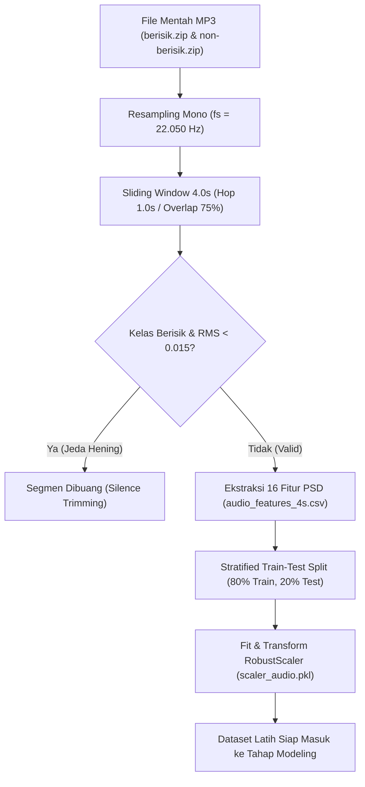

# Data Preprocessing

Tahap **Data Preprocessing** (Pra-pemrosesan Data) merupakan jembatan krusial dalam metodologi CRISP-DM yang mentransformasikan rekaman audio analog-ke-digital mentah menjadi matriks fitur tabular yang bersih, seimbang, dan siap dilatih oleh algoritma *Machine Learning*.

Dalam proyek ini, dirancang sebuah pipeline pra-pemrosesan berstandar ilmiah yang mencakup empat tahapan utama:
1. **Segmentasi Jendela Geser (*Sliding Window Overlap 75%*)**
2. **Pembersihan Jeda Hening (*Silence Trimming / Energy Thresholding*)**
3. **Pembagian Data Berstrata (*Stratified Train-Test Split 80:20*)**
4. **Penskalaan Fitur Kebal Pencilan (*RobustScaler Normalization*)**

---

## 1. Segmentasi Jendela Geser (*Sliding Window Segmentation*)
Pada analisis audio digital, pemotongan waktu secara kaku tanpa pergeseran (*non-overlapping rigid segmentation*) memiliki kelemahan fatal: jika suatu suara bising mendadak (misalnya bunyi klakson, teriakan, atau dentuman) terjadi tepat di perbatasan potongan waktu (misalnya detik ke-3.8 hingga 4.4), gelombang suara tersebut akan terpotong menjadi dua fragmen tak lengkap. Akibatnya, informasi spektral gelombang menjadi cacat dan merusak akurasi pengenalan pola.

Untuk mengatasi permasalahan ini, diterapkan teknik **Sliding Window** dengan parameter berikut:
- **Panjang Jendela (*Window Size / Segment Duration*):** $T_{\text{win}} = 4.0\text{ detik}$
  $$N_{\text{samples}} = f_s \times T_{\text{win}} = 22.050 \times 4.0 = 88.200\text{ sampel}$$
- **Pergeseran Jendela (*Hop Size / Hop Duration*):** $T_{\text{hop}} = 1.0\text{ detik}$
  $$N_{\text{hop}} = f_s \times T_{\text{hop}} = 22.050 \times 1.0 = 22.050\text{ sampel}$$
- **Rasio Tumpang Tindih (*Overlap Ratio*):**
  $$\text{Overlap} = \frac{T_{\text{win}} - T_{\text{hop}}}{T_{\text{win}}} \times 100\% = \frac{4.0 - 1.0}{4.0} \times 100\% = 75\%$$

```text
Visualisasi Sliding Window 4s (Hop 1s / Overlap 75%):

Waktu (Detik)  0s      1s      2s      3s      4s      5s      6s
Sinyal Audio:  |-------|-------|-------|-------|-------|-------|
Segmen #1:     [=============== 4.0 Detik ===============]
Segmen #2:             [=============== 4.0 Detik ===============]
Segmen #3:                     [=============== 4.0 Detik ===============]
               <--1s--> Hop
               <------------ 3s Tumpang Tindih (75%) ----------->
```

### Keuntungan Ilmiah Pendekatan Ini:
1. **Menghilangkan Efek Terpotong (*Boundary Invariance*):** Seluruh transisi suara bising tertangkap secara utuh setidaknya di dalam satu jendela pengamatan.
2. **Multiplikasi Data Nyata (Augmentasi Temporal):** Dari 200 berkas audio rekaman mentah (@ ~30 detik), teknik ini menghasilkan **5.286 segmen audio nyata** tanpa perlu membuat data sintetis buatan (*no artificial synthetic noise*).
3. **Sinkronisasi Sempurna dengan Sistem Monitoring Real-Time:** Resolusi jendela 4 detik dengan pergeseran 1 detik meniru secara presisi cara kerja penyangga memori (*audio circular buffer*) pada mikrofon saat memantau suara lingkungan secara langsung.

---

## 2. Pembersihan Jeda Hening (*Silence Trimming / Energy Thresholding*)
Saat merekam berkas audio kelas bising di lapangan, kerap kali terjadi jeda hening selama 1 hingga 2 detik di bagian awal (*intro*) sebelum keributan dimulai, atau di bagian akhir (*outro*) setelah keributan mereda. Jika potongan hening ini dimasukkan ke dalam data latih dengan label "Berisik (1)", model akan mengalami kebingungan (*label noise* / kontaminasi label), sehingga model dapat salah memprediksi ruangan hening sebagai bising di kemudian hari.

Untuk mencegah kontaminasi tersebut, diterapkan algoritma **Silence Trimming**:
$$\text{Ambang Batas Hening Minimal: } \text{MIN\_RMS\_BERISIK} = 0.015$$

### Logika Penyaringan:
Pada setiap segmen 4 detik yang diekstraksi dari kelas Berisik (`label = 1`), sistem menghitung nilai energi fisik RMS-nya:
- Jika $\text{RMS} < 0.015$, segmen tersebut dikategorikan sebagai jeda hening kosong dan **otomatis dibuang (dieliminasi)** dari data latih.
- Jika $\text{RMS} \ge 0.015$, segmen tersebut dipertahankan sebagai sampel berisik valid.

> [!IMPORTANT]
> **Catatan Integritas Data:** Label kelas dasar **TIDAK PERNAH DIUBAH SECARA SEPIHAK**. Proses ini murni merupakan pembersihan segmen kosong (*silence trimming*) pada tahap pra-pemrosesan, memastikan bahwa data latih kelas berisik benar-benar memuat gelombang suara gaduh yang aktif.

---

## 3. Pembagian Data Berstrata (*Stratified Train-Test Split*)
Dataset yang telah bersih (**5.286 baris segmen**) kemudian dibagi menjadi dua subset independen:
- **Data Latih (*Training Set*):** $80\%$ ($N = 4.228$ sampel) — Digunakan untuk melatih model dan proses penalaan hiperparameter (*hyperparameter tuning*).
- **Data Uji (*Testing Set*):** $20\%$ ($N = 1.058$ sampel) — Digunakan khusus untuk mengevaluasi generalisasi performa model pada data yang belum pernah dilihat sebelumnya (*unseen data*).

```python
X_train, X_test, y_train, y_test = train_test_split(
    X, y,
    test_size=0.2,
    stratify=y,
    random_state=42
)
```

### Mengapa Menggunakan *Stratified Split*?
Metode pembagian berstrata (`stratify=y`) menjamin bahwa proporsi kelas **Berisik** dan **Non-Berisik** pada subset data latih dan data uji tetap identik dengan populasi aslinya:

| Subset Data | Total Sampel | Kelas Non-Berisik (0) | Kelas Berisik (1) | Rasio Keseimbangan |
|---|---|---|---|---|
| **Keseluruhan** | 5.286 | 2.732 ($51.68\%$) | 2.554 ($48.32\%$) | Seimbang |
| **Data Latih (80%)** | 4.228 | 2.185 ($51.68\%$) | 2.043 ($48.32\%$) | Seimbang |
| **Data Uji (20%)** | 1.058 | 547 ($51.70\%$) | 511 ($48.30\%$) | Seimbang |

---

## 4. Normalisasi Fitur Kebal Pencilan (*RobustScaler Normalization*)
Enam belas fitur akustik yang diekstraksi memiliki rentang nilai (*scale*) yang sangat berbeda drastis. Contohnya:
- RMS Energy memiliki rentang nilai berkisar antara $0.0001$ hingga $0.44$.
- Zero Crossing Rate berkisar antara $0.008$ hingga $0.38$.
- Spectral Centroid berkisar antara $300\text{ Hz}$ hingga $5.800\text{ Hz}$.
- MFCC 1 berkisar antara $-480$ hingga $+12$.

Algoritma berbasis jarak geometris seperti **K-Nearest Neighbors (KNN)** sangat sensitif terhadap perbedaan skala. Jika fitur tidak dinormalisasi, variabel dengan skala ribuan (seperti Spectral Centroid) akan mendominasi perhitungan jarak dan menenggelamkan pengaruh fitur penting lainnya seperti RMS.

### Mengapa Memilih `RobustScaler` Bukan `StandardScaler`?
Perbandingan kritis antara metode normalisasi:

1. **`StandardScaler` ($\frac{x - \mu}{\sigma}$):**
   Menggunakan rata-rata ($\mu$) dan standar deviasi ($\sigma$). Pada sinyal audio, suara letupan mendadak (*burst noise*, tepukan keras, atau dentuman sesaat) menghasilkan nilai pencilan ekstrem (*outliers*). Nilai ekstrem ini merusak rata-rata dan memperbesar simpangan baku, sehingga memadatkan sebagian besar data normal lainnya dan menurunkan akurasi klasifikasi.
2. **`MinMaxScaler` ($\frac{x - x_{\min}}{x_{\max} - x_{\min}}$):**
   Sangat rapuh karena batas skala $[0, 1]$ sepenuhnya ditentukan oleh nilai minimum dan maksimum ekstrem.
3. **`RobustScaler` (Pilihan Terbaik untuk Audio):**
   Mentransformasikan fitur menggunakan **Median** dan **Interquartile Range (IQR)**:
   $$x_{\text{scaled}} = \frac{x - \text{Median}(x)}{Q_3 - Q_1} = \frac{x - \text{Median}(x)}{\text{IQR}}$$

Di mana:
- $\text{Median}(x)$ adalah kuartil kedua ($Q_2$ / nilai tengah data).
- $Q_1$ adalah kuartil pertama (persentil ke-25).
- $Q_3$ adalah kuartil ketiga (persentil ke-75).
- $\text{IQR} = Q_3 - Q_1$ adalah rentang interkuartil yang memuat $50\%$ data inti.

> [!TIP]
> **Keunggulan RobustScaler:** Karena Median dan IQR tidak terpengaruh oleh letupan sinyal ekstrem, vektor 16 fitur tetap terdistribusi secara proporsional dan objektif, memberikan fondasi matematis terbaik bagi model KNN dalam menghitung kedekatan tetangga.

---

## 5. Ringkasan Alur Pipeline Pra-Pemrosesan
Seluruh alur pra-pemrosesan data sinyal audio dirangkum dalam diagram berikut:


