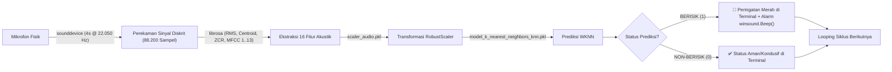

# Deployment

Tahap **Deployment** (Penerapan) merupakan fase puncak dalam siklus hidup sains data (*Data Science Lifecycle*), di mana model *Machine Learning* yang telah dilatih dan divalidasi diintegrasikan ke dalam lingkungan operasional nyata.

Pada proyek ini, sistem klasifikasi audio berisik di-deploy ke dalam dua platform terpisah yang saling melengkapi:
1. **Mode Terminal Mandiri (*Command-Line Interface / CLI*):** Skrip [`live_audio_detect.py`](../../data/klasifikasi-audio/live_audio_detect.py) untuk pemantauan latar belakang (*headless/server*) pada perangkat cerdas atau mini-PC.
2. **Aplikasi Dasbor Web Interaktif (*Streamlit Web App*):** Aplikasi modern [`app.py`](../../data/klasifikasi-audio/app.py) dengan visualisasi gelombang spektral, metrik KPI dinamis, alarm audio otomatis, pengujian berkas rekaman, dan riwayat log real-time.

---

## 1. Arsitektur Deployment & Ekspor Artefak Model

Setelah proses pelatihan pada `train.ipynb` selesai, artefak model dan pipeline normalisasi diekspor ke disk menggunakan pustaka serialisasi biner `joblib`:

```python
# Ekspor Model WKNN dan Objek RobustScaler
joblib.dump(chosen_model, "model_k_nearest_neighbors_knn.pkl")
joblib.dump(scaler, "scaler_audio.pkl")
```

### Artefak yang Dihasilkan:
- **`model_k_nearest_neighbors_knn.pkl` ($\approx 575\text{ KB}$):** Berkas biner model WKNN ($K=4$, distance weights) yang memuat koordinat ruang fitur 16 dimensi dari $4.228$ sampel data latih.
- **`scaler_audio.pkl` ($\approx 1.1\text{ KB}$):** Objek `RobustScaler` terlatih yang menyimpan vektor Median ($Q_2$) dan Interquartile Range ($\text{IQR} = Q_3 - Q_1$) dari 16 fitur akustik untuk penskalaan instan data audio baru.

Kedua berkas ini dimuat secara terisolasi ke memori (*caching*) menggunakan dekorator `@st.cache_resource` pada aplikasi web sehingga hanya perlu dimuat satu kali saat server pertama kali diaktifkan.

---

## 2. Mode Terminal (CLI) Mandiri (`live_audio_detect.py`)

Skrip [`live_audio_detect.py`](../../data/klasifikasi-audio/live_audio_detect.py) dirancang untuk kebutuhan pemantauan tanpa antarmuka grafis (*headless mode*), sangat cocok dijalankan di lingkungan Linux Server, Raspberry Pi, atau terminal *Command Prompt*.



### Cuplikan Logika Inti `live_audio_detect.py`:

```python
import time, winsound, librosa, joblib
import numpy as np
import sounddevice as sd

# Memuat model dan scaler
model = joblib.load("model_k_nearest_neighbors_knn.pkl")
scaler = joblib.load("scaler_audio.pkl")

def trigger_sound_alert():
    """Membunyikan nada bip sistem frekuensi 1500 Hz selama 500 ms"""
    winsound.Beep(1500, 500)

def extract_live_features(audio_data, sr=22050, n_mfcc=13):
    """Mengekstrak 16 fitur audio dari rekaman 4 detik mikrofon"""
    rms = float(np.mean(librosa.feature.rms(y=audio_data)))
    centroid = float(np.mean(librosa.feature.spectral_centroid(y=audio_data, sr=sr)))
    zcr = float(np.mean(librosa.feature.zero_crossing_rate(y=audio_data)))
    mfcc = librosa.feature.mfcc(y=audio_data, sr=sr, n_mfcc=n_mfcc)
    mfcc_mean = np.mean(mfcc, axis=1)
    return np.array([rms, centroid, zcr] + [float(m) for m in mfcc_mean]).reshape(1, -1)

# Siklus pemantauan kontinu 4 detik
while True:
    audio_chunk = sd.rec(int(4.0 * 22050), samplerate=22050, channels=1, dtype='float32')
    sd.wait() # Tunggu perekaman 4 detik selesai
    
    raw_feats = extract_live_features(audio_chunk.flatten())
    scaled_feats = scaler.transform(raw_feats)
    prediction = model.predict(scaled_feats)[0]
    
    if prediction == 1:
        print("🚨 [PERINGATAN] TERDETEKSI SUARA BERISIK DALAM 4 DETIK TERAKHIR!")
        trigger_sound_alert()
    else:
        print("✅ [AMAN] KONDISI TENANG / NON-BERISIK")
```

### Cara Menjalankan Mode CLI:
Cukup jalankan perintah berikut di terminal:
```bash
python live_audio_detect.py
```
*(Tekan `Ctrl+C` kapan saja untuk menghentikan pemantauan).*

---

## 3. Aplikasi Web Dashboard Streamlit (`app.py`)

Aplikasi web [`app.py`](../../data/klasifikasi-audio/app.py) menyajikan antarmuka pengguna interaktif dengan standar desain modern (tipografi *IBM Plex Sans*, palet warna *Teal, Ink, Slate, Rose*, dan 100% SVG Heroicons inline tanpa *emoji/emote* konvensional).

Aplikasi dibangun dengan arsitektur modular yang rapi:
- **[`app.py`](../../data/klasifikasi-audio/app.py):** Pengendali utama (*controller*), manajemen state (`st.session_state`), tata letak tab, dan alur eksekusi aplikasi.
- **[`audio_utils.py`](../../data/klasifikasi-audio/audio_utils.py):** Pustaka fungsi perekaman audio mikrofon (`sounddevice`), ekstraksi 16 fitur PSD, analisis pemotongan segmen berkas audio, dan pemanggil alarm Windows.
- **[`charts.py`](../../data/klasifikasi-audio/charts.py):** Pembuat grafik interaktif Plotly: *Waveform* sinyal waktu riil dengan garis batas $\pm\text{RMS}$ dan *Bar Chart* 13 koefisien spektral MFCC bergradasi warna adaptif.
- **[`components.py`](../../data/klasifikasi-audio/components.py):** Komponen kartu status cerdas, kartu metrik KPI, visualizer gelombang audio 60 FPS HTML5 Canvas, tabel confusion matrix 2x2, serta koleksi SVG Heroicons.
- **[`style.css`](../../data/klasifikasi-audio/style.css):** Lembar gaya CSS mandiri untuk *design system* antarmuka.

---

### Eksplorasi Fitur di Setiap Tab Aplikasi

#### A. Tab 1: Monitoring Real-Time & Uji Audio
1. **Panel Kontrol Fleksibel:**
   - Pemilihan mikrofon aktif dari daftar perangkat audio perangkat keras yang terdeteksi di sistem (`sounddevice.query_devices()`).
   - Selektor durasi jendela model (default **4.0 Detik**, sinkron dengan model *training*).
   - Sakelar alarm audio (*sound alert toggle*) untuk mengaktifkan nada bip sistem jika kebisingan terdeteksi.
2. **Tombol Operasi Cepat:**
   - **Mulai Monitoring Real-Time:** Menjalankan pemantauan berkelanjutan otomatis setiap 4 detik.
   - **Uji 1 Siklus (4 Detik):** Merekam 1 jendela audio sesaat dan menganalisis status kebisingannya seketika.
   - **Bersihkan Log Riwayat:** Mengosongkan memori tabel log deteksi.
3. **Pengujian Berkas Audio Rekaman (.wav / .mp3 / .ogg / .flac):**
   - Opsi pengujian mandiri tanpa membutuhkan mikrofon aktif.
   - Pengguna mengunggah rekaman audio suara lingkungan. Sistem secara otomatis memotong rekaman tersebut ke dalam segmen-segmen 4 detik, mengekstrak 16 fitur per segmen, dan memprediksi status kebisingannya.
   - Dilengkapi visualisasi grafik *Timeline* gelombang audio utuh dengan penandaan warna: segmen merah untuk berisik dan segmen hijau untuk tenang.
4. **Visualizer Gelombang Akustik 60 FPS:**
   - Komponen visualizer HTML5 Canvas independen yang berdenyut secara halus mengikuti gelombang akustik ruangan.
5. **Kartu Status Cerdas & Metrik KPI:**
   - **Status Berisik (Rose Card):** Menampilkan peringatan warna merah tua, tingkat keyakinan (*confidence level* %), indikator fisis (RMS, Centroid, ZCR), akumulasi durasi berisik (misal: 3 siklus berturut-turut = 12 detik), serta rekomendasi tindakan praktis.
   - **Status Non-Berisik (Teal Card):** Menampilkan status kondusif dan hening dengan warna hijau toska yang menenangkan.
6. **Grafik Spektral Plotly Interaktif:**
   - *Waveform Plot:* Grafik gelombang amplitudo sinyal 4 detik dengan garis putus-putus penanda batas $\pm\text{RMS}$.
   - *MFCC Bar Chart:* Profil batang 13 koefisien spektral Mel yang berubah warna sesuai status prediksi (merah untuk bising, hijau untuk tenang).
7. **Tabel Log Riwayat & Tombol Unduh CSV:**
   - Mencatat seluruh riwayat siklus deteksi (nomor siklus, timestamp, status, confidence, RMS, Centroid, ZCR).
   - Dilengkapi tombol **Unduh Log Riwayat CSV** untuk kebutuhan dokumentasi dan audit lingkungan.

#### B. Tab 2: Data & Ekstraksi Fitur
- Eksplorasi dataset tabular [`audio_features_4s.csv`](../../data/klasifikasi-audio/audio_features_4s.csv) (**5.286 baris segmen fitur**).
- Filter interaktif berdasarkan kategori label (*Semua Kategori, Berisik (1), Non-Berisik (0)*) dan kotak pencarian nama berkas audio asli.
- Tampilan kartu metrik statistika deskriptif (rata-rata RMS, rentang Spectral Centroid, dan rata-rata ZCR).
- Tabel pratinjau data interaktif serta tombol unduh dataset dalam format CSV.

#### C. Tab 3: Informasi Model & Arsitektur
- Kartu spesifikasi teknis model: Algoritma WKNN ($K=4$, distance weights, Euclidean, RobustScaler).
- Empat metrik utama evaluasi (Akurasi 97.64%, 5-Fold CV 97.58%, Precision Berisik 98.60%, Recall Non-Berisik 98.72%).
- Visualisasi Matriks Kebingungan 2x2 interaktif.
- Tabel perbandingan komparatif benchmark 12 algoritma Machine Learning.
- Penjelasan teknis 16 fitur akustik PSD beserta rumus matematisnya.
- Diagram alir 4 tahapan pipeline pemrosesan sinyal real-time 4 detik (88.200 sampel).

---

## 4. Struktur Direktori Proyek

Seluruh kode sumber dan berkas pendukung tersimpan rapi di dalam repositori:

```text
data/klasifikasi-audio/
├── .streamlit/
│   └── config.toml                  # Konfigurasi tema dan server Streamlit
├── app.py                           # Kode utama aplikasi web Streamlit
├── audio_utils.py                   # Utilitas ekstraksi fitur, perekaman audio 4s, & prediksi
├── components.py                    # Komponen UI, Heroicons SVG inline, & templates
├── charts.py                        # Pembuat visualisasi grafik interaktif Plotly
├── style.css                        # Design system & CSS stylesheet mandiri
├── live_audio_detect.py             # Skrip CLI pemantauan audio 4 detik mandiri dari terminal
├── train.ipynb                      # Notebook ekstraksi fitur 4s, pelatihan, & evaluasi WKNN
├── audio_features_4s.csv            # Dataset 16 fitur akustik (5.286 baris segmen)
├── model_k_nearest_neighbors_knn.pkl# Model WKNN (K=4, distance weights, Akurasi 97.64%)
├── scaler_audio.pkl                 # Objek RobustScaler terlatih
├── berisik.zip                      # Arsip 100 rekaman audio mentah kelas berisik
├── non-berisik.zip                  # Arsip 100 rekaman audio mentah kelas non-berisik
└── README.md                        # Dokumentasi teknis proyek lengkap
```

---

## 5. Panduan Menjalankan Sistem

### A. Prasyarat Lingkungan
Pastikan Anda menggunakan **Python 3.9 atau yang lebih baru** dan telah menginstal dependensi yang diperlukan:

```bash
pip install streamlit librosa sounddevice numpy pandas scikit-learn joblib plotly
```

### B. Menjalankan Aplikasi Web Streamlit
Buka terminal, arahkan ke direktori proyek, dan jalankan perintah:

```bash
streamlit run app.py
```

Setelah server aktif, buka peramban web di alamat:
**`http://localhost:8501`**

### C. Menjalankan Mode Terminal (CLI)
Untuk menjalankan pemantauan mikrofon mandiri langsung dari terminal/command prompt:

```bash
python live_audio_detect.py
```

Sistem akan langsung mendengarkan aliran suara mikrofon secara kontinu setiap jendela 4 detik dan membunyikan alarm peringatan seketika saat kebisingan terdeteksi.
