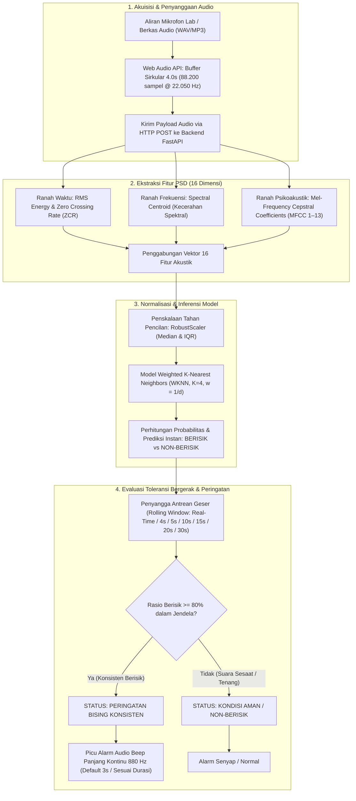
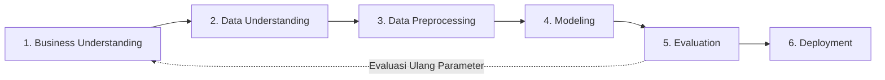

# Klasifikasi & Deteksi Real-Time Audio Berisik Menggunakan Weighted K-Nearest Neighbors (WKNN 4s)

Dokumen ini merupakan intisari komprehensif (*Master Summary*) proyek sains data dan Pengolahan Sinyal Digital (PSD) untuk klasifikasi dan deteksi tingkat kebisingan lingkungan akustik secara *real-time* di **Laboratorium Teknik Informatika**.

Proyek ini disusun dan diimplementasikan secara end-to-end mengacu pada standar metodologi **CRISP-DM (Cross-Industry Standard Process for Data Mining)**, mencakup:
1. Pemahaman masalah operasional akademik di Laboratorium Teknik Informatika (*Business Understanding*).
2. Akuisisi sinyal akustik mentah dan ekstraksi 16 parameter Pengolahan Sinyal Digital (*Data Understanding*).
3. Segmentasi jendela geser 4 detik, pembersihan jeda hening (*silence trimming*), dan penskalaan tahan pencilan (*Data Preprocessing*).
4. Eksperimen komparatif 12 algoritma *Machine Learning* dan perumusan matematis *Weighted K-Nearest Neighbors* (*Modeling*).
5. Validasi kuantitatif menggunakan Matriks Kebingungan, 5-Fold Stratified Cross Validation, dan kurva ROC-AUC (*Evaluation*).
6. Penyebaran sistem produksi full-stack modern berbasis FastAPI (Backend REST API), React 19 + TypeScript + Vite + Tailwind CSS (Frontend SPA), Web Audio API + HTML5 Canvas (Visualizer 60 FPS), logika toleransi bergerak (*Rolling Window*), sintesis nada beep kontinu 880 Hz, serta orkestrasi *Multi-Stage* Docker (*Deployment*).

---

## 1. Ringkasan Spesifikasi Teknis & Hasil Proyek

Sistem membagi sinyal rekaman suara ke dalam bingkai waktu **4.0 detik per segmen** dengan pergeseran jendela (*sliding window hop*) sebesar **1.0 detik (overlap 75%)** serta teknik **pembersihan jeda hening (*silence trimming*)** pada ambang $\text{RMS} \ge 0.015$. Pendekatan ini menghasilkan **5.286 segmen fitur audio nyata** yang direkam langsung dari Laboratorium Teknik Informatika secara seimbang tanpa data sintetis, menghasilkan model klasifikasi yang sangat presisi dan andal untuk diterapkan di dunia nyata.

| Parameter Proyek | Spesifikasi Teknis | Keterangan & Rationale |
|---|---|---|
| **Domain Masalah** | Klasifikasi Audio Biner | Membedakan kondisi **Berisik (*Noisy*)** vs **Non-Berisik (*Clean/Quiet*)** di Lab |
| **Lokasi & Data** | Laboratorium Teknik Informatika | Sampel data direkam dan diimplementasikan langsung di dalam laboratorium |
| **Algoritma Terpilih** | **Weighted K-Nearest Neighbors (WKNN)** | Model berbasis instans dengan pembobotan jarak terbalik (*Distance-Weighted*) |
| **Jumlah Tetangga ($K$)** | $K = 4$ Tetangga | Nilai genap dengan pembobotan jarak kontinu untuk memecahkan *tie* klasifikasi biner |
| **Metrik Jarak** | Jarak Minkowski ($p=2$ / Euclidean) | Mengukur kedekatan geometris antarvektor 16 fitur spektral ternormalisasi |
| **Skema Pembobotan** | *Inverse Distance Weighting* ($w_i = 1/d_i$) | Tetangga yang lebih dekat memiliki pengaruh probabilitas voting lebih besar |
| **Metode Normalisasi** | `RobustScaler` (Median & IQR) | Kebal terhadap letupan suara mendadak (*burst noise/outlier*) |
| **Panjang Jendela (*Window*)** | 4.0 Detik ($88.200$ sampel @ $22.050\text{ Hz}$) | Resolusi waktu optimal untuk menangkap karakteristik spektral stabil |
| **Pergeseran Jendela (*Hop*)**| 1.0 Detik ($22.050$ sampel / Overlap $75\%$) | Menjaga kontinuitas transisi akustik antar-detik |
| **Pembersihan Hening** | $\text{RMS} \ge 0.015$ (Kelas Berisik) | Mengeliminasi jeda intro/outro kosong saat merekam (*silence trimming*) |
| **Total Segmen Fitur** | **5.286 baris segmen audio** | Terbagi seimbang: 2.732 Non-Berisik ($51.68\%$) vs 2.554 Berisik ($48.32\%$) |
| **Pembagian Data** | Stratified Split 80:20 | 4.228 data latih (*training set*) vs 1.058 data uji (*test set*) |
| **Akurasi Data Uji (Test)** | **97.64%** ($N = 1.058$ sampel uji) | Mengungguli 11 algoritma pembanding lainnya |
| **5-Fold Cross Validation** | **97.58% (+/- 0.58%)** | Fold tertinggi mencapai **98.20%**, membuktikan stabilitas model |
| **Presisi Kelas Berisik** | **98.60%** | Sangat andal, meminimalkan alarm palsu (*false alarm* hanya 7 kasus / $1.28\%$) |
| **Recall Non-Berisik** | **98.72%** | 540 dari 547 sampel audio tenang berhasil dikenali dengan sempurna |
| **Waktu Inferensi** | $\approx 8 - 15\text{ ms}$ per jendela 4s | Mampu memproses aliran mikrofon secara kontinu tanpa *delay* |
| **Backend API** | FastAPI (Python 3.12/3.13) | *In-memory singleton lifespan*, RESTful endpoints, kompresi GZip |
| **Frontend UI** | React 19 + TypeScript + Tailwind CSS | Antarmuka SPA modern, palet warna Teal & latar putih, tipografi Poppins |
| **Visualisasi Audio** | Web Audio API + HTML5 Canvas | Osiloskop gelombang & spektrogram frekuensi 60 FPS latar putih |
| **Mekanisme Toleransi** | *Rolling Window Buffer* | Real-Time, 4s, 5s, 10s, 15s, 20s, 30s dengan ambang konsistensi bising $\ge 80\%$ |
| **Peringatan Suara** | Web Audio API Oscillator | Nada sinus 880 Hz kontinu tanpa henti (default 3 detik, kustom 1s-5s, *mute toggle*) |
| **Kontainerisasi** | Docker & Docker Compose | *Multi-stage build* (Node 22 + Python 3.12-slim), produksi port `8080` |

---

## 2. Diagram Alir Arsitektur Sistem

Pipeline pemrosesan data, inferensi model, dan mekanisme deteksi toleransi bergerak diilustrasikan pada diagram berikut:



---

## 3. Ekstraksi 16 Parameter Akustik Pengolahan Sinyal Digital (PSD)

Sistem mengekstraksi 16 parameter akustik yang merepresentasikan karakteristik suara dari tiga ranah domain sinyal:

| No | Parameter Fitur | Ranah Sinyal | Definisi Matematis | Signifikansi Fisik di Lab |
|---|---|---|---|---|
| 1 | **RMS Energy** | Waktu | $\text{RMS} = \sqrt{\frac{1}{N} \sum_{n=0}^{N-1} x[n]^2}$ | Daya fisik dan amplitudo suara; membedakan keheningan dari keriuhan. |
| 2 | **Zero Crossing Rate (ZCR)** | Waktu | $\text{ZCR} = \frac{1}{2(N-1)} \sum_{n=1}^{N-1} |\text{sgn}(x[n]) - \text{sgn}(x[n-1])|$ | Frekuensi pelintasan amplitudo nol; mendeteksi derau gesekan kursi dan ketikan keyboard. |
| 3 | **Spectral Centroid** | Frekuensi | $C = \frac{\sum_{k=0}^{K-1} f_k \cdot \|X[k]\|}{\sum_{k=0}^{K-1} \|X[k]\|}$ | Pusat massa spektrum (kecerahan suara); suara obrolan vokal memiliki centroid lebih tinggi dari dengung AC. |
| 4–16 | **MFCC 1–13** | Mel-Frequency | $c_n = \sum_{m=0}^{M-1} \log(\tilde{S}[m]) \cos\left( \frac{\pi n (m + 0.5)}{M} \right)$ | Selubung spektral fonetik vokal manusia dan struktur resonansi ruangan laboratorium. |

---

## 4. Sintesis Fase Metodologi CRISP-DM

Implementasi proyek disusun dalam 6 fase standar CRISP-DM yang saling berkesinambungan:



### Fase 1: Business Understanding
- **Fokus Permasalahan:** Pengawasan kebisingan manual di Laboratorium Teknik Informatika membebani asisten laboratorium, bersifat subjektif, dan tidak terdokumentasi secara kuantitatif.
- **Solusi Rekayasa:** Membangun sistem pendeteksi kebisingan cerdas berbasis machine learning dengan waktu inferensi $< 15\text{ ms}$, antarmuka web modern reaktif, mekanisme toleransi kebisingan konsisten, dan alarm audio yang dapat dikustomisasi.
- **Dokumentasi Lengkap:** [business-understanding.md](business-understanding.md)

### Fase 2: Data Understanding
- **Karakteristik Data:** 200 berkas audio rekaman WAV mentah yang diambil langsung dari lingkungan nyata Laboratorium Teknik Informatika (100 rekaman Berisik dan 100 rekaman Non-Berisik).
- **Dasar Digitalisasi:** Teorema Nyquist-Shannon pada $f_s = 22.050\text{ Hz}$ dengan frekuensi lipatan (*Nyquist limit*) sebesar $11.025\text{ Hz}$, mencakup seluruh spektrum suara vokal dan kegaduhan mekanis.
- **Karakteristik Ambang:** Analisis *noise floor* mikrofon laptop berada pada $\text{RMS} \approx 0.003 - 0.012$, sehingga ambang hening ditetapkan pada $\text{RMS} = 0.015$, dan batas saturasi/kliping pada $\text{RMS} = 0.220$.
- **Dokumentasi Lengkap:** [data-understanding.md](data-understanding.md)

### Fase 3: Data Preprocessing
- **Segmentasi Jendela Geser:** Jendela 4.0 detik ($88.200$ sampel) dengan *hop size* 1.0 detik ($22.050$ sampel, *overlap* 75%), meningkatkan volume data dari 200 rekaman mentah menjadi 5.286 segmen teranotasi.
- **Pembersihan Hening (*Silence Trimming*):** Filter segmen berisik beramplitudo rendah ($\text{RMS} < 0.015$) dibuang guna mencegah model mempelajari jeda hening sebagai kelas bising.
- **Pembagian Data Berstrata:** Rasio 80:20 menghasilkan 4.228 sampel data latih dan 1.058 sampel data uji dengan proporsi kelas seimbang ($51.68\%$ Non-Berisik vs $48.32\%$ Berisik).
- **Penskalaan Tahan Pencilan:** Menggunakan `RobustScaler` berbasis Median dan *Interquartile Range* (IQR) untuk mencegah distorsi akibat suara letupan sesaat (*burst noise*).
- **Dokumentasi Lengkap:** [data-preprocessing.md](data-preprocessing.md)

### Fase 4: Modeling
- **Eksperimen Komparatif:** Menguji 12 algoritma klasifikasi machine learning (WKNN, KNN Uniform, MLP Neural Network, Extra Trees, Random Forest, Decision Tree, SVM RBF, Gradient Boosting, AdaBoost, SVM Linear, Logistic Regression, Gaussian Naive Bayes).
- **Formulasi Matematis WKNN:** Menggunakan algoritma *Weighted K-Nearest Neighbors* ($K=4$, metrik Minkowski Euclidean $p=2$, skema bobot $w_i = \frac{1}{d(x, x_i)}$).
- **Resolusi Tie-Breaker:** Nilai bobot jarak kontinu pada $K=4$ secara matematis mengeliminasi probabilitas hasil imbang ($P(\text{tie}) \to 0$) pada klasifikasi biner.
- **Serialisasi Artefak:** Pipeline model disimpan dalam format biner Python pickle: `backend/app/models/model_k_nearest_neighbors_knn.pkl` dan `backend/app/models/scaler_audio.pkl`.
- **Dokumentasi Lengkap:** [modeling.md](modeling.md)

### Fase 5: Evaluation
- **Kinerja Data Uji:** Akurasi pengujian mencapai **97.64%** ($N = 1.058$ sampel uji).
- **Kinerja Per Kelas:**
  - Kelas Berisik: Presisi **98.60%**, Recall **96.48%**, F1-Score **97.53%**.
  - Kelas Non-Berisik: Presisi **96.77%**, Recall **98.72%**, F1-Score **97.74%**.
- **Stabilitas 5-Fold Stratified Cross Validation:** Rata-rata akurasi **97.58% $\pm 0.58\%$** dengan skor fold tertinggi mencapai **98.20%**.
- **Matriks Kebingungan ($2 \times 2$):**
  - True Negative ($\text{TN}$): 540 sampel non-berisik terklasifikasi benar.
  - False Positive ($\text{FP}$): 7 sampel non-berisik terprediksi berisik (*false alarm* $1.28\%$).
  - False Negative ($\text{FN}$): 18 sampel berisik terlewat (*missed detection* $3.52\%$).
  - True Positive ($\text{TP}$): 493 sampel berisik terklasifikasi benar.
- **Kemampuan Diskriminasi ROC-AUC:** Area under curve mencapai **0.9972**, membuktikan batas pemisah kelas yang sangat tegas.
- **Uji Latensi:** Rata-rata inferensi backend berkisar antara $8 - 15\text{ ms}$, jauh di bawah batas toleransi waktu riil $1.000\text{ ms}$.
- **Dokumentasi Lengkap:** [evaluation.md](evaluation.md)

### Fase 6: Deployment
- **Backend Modern:** FastAPI dengan pola arsitektur *asynchronous in-memory singleton*, memuat model dan scaler ke dalam memori RAM saat *lifespan startup* dan melakukan pemanasan JIT compiler.
- **REST Endpoints:** Menyediakan `/api/predict-live` (inferensi buffer mikrofon), `/api/predict/file` (analisis audio rekaman), `/api/model-info` (metadata model), dan `/api/health` (liveness probe).
- **Frontend SPA Reaktif:** Antarmuka web berbasis React 19, TypeScript, Vite, dan Tailwind CSS dengan tema Teal (`#0D9488`, `#0F766E`, `#115E59`, `#E7F4F2`), tipografi Poppins, dan ikon SVG murni tanpa emoji.
- **Visualisasi Gelombang 60 FPS:** Dua kanvas HTML5 berlatar belakang putih bersih untuk visualisasi osiloskop waktu-nyata dan spektrogram frekuensi audio.
- **Mekanisme Toleransi Bergerak (*Rolling Window Consistency*):** Penyangga geser dengan opsi durasi konsistensi (*Real-Time*, 4s, 5s, 10s, 15s, 20s, 30s) dan ambang bising konsisten $\ge 80\%$, mencegah alarm palsu akibat suara sesaat (seperti batuk atau pintu tertutup).
- **Alarm Audio Beep Kontinu 880 Hz:** Peringatan suara gelombang sinus 880 Hz yang berbunyi secara kontinu tanpa jeda putus-putus, berdurasi bawaan 3 detik, dapat dikustomisasi antara 1 hingga 5 detik, serta dilengkapi sakelar pembisuan (*Mute switch*).
- **Kontainerisasi Docker Multi-Stage:** Berkas `Dockerfile` dan `docker-compose.yml` menggabungkan *build environment* Node.js 22 LTS untuk frontend dan Python 3.12-slim untuk backend ke dalam satu kontainer ringan yang disajikan pada port `8080`.
- **Dokumentasi Lengkap:** [deployment.md](deployment.md)

---

## 5. Ringkasan Perbandingan Benchmark 12 Model

Hasil evaluasi komparatif 12 algoritma machine learning pada dataset audio Laboratorium Teknik Informatika disajikan pada tabel berikut:

| Peringkat | Algoritma Klasifikasi | Akurasi Test (%) | F1-Score Makro (%) | 5-Fold CV (%) | Waktu Inferensi / Sampel | Keterangan Seleksi |
|---|---|---|---|---|---|---|
| **1** | **Weighted KNN ($K=4$, distance)** | **97.64%** | **97.63%** | **97.58% $\pm 0.58\%$** | **0.012 ms** | **Model Terpilih (Akurasi & Stabilitas Tertinggi)** |
| 2 | Baseline KNN ($K=5$, uniform) | 97.45% | 97.44% | 97.35% $\pm 0.65\%$ | 0.012 ms | Rentan terhadap masalah voting imbang |
| 3 | MLP (Neural Network 100-50) | 97.26% | 97.25% | 97.10% $\pm 0.72\%$ | 0.045 ms | Waktu komputasi lebih tinggi, model kotak hitam |
| 4 | Extra Trees Classifier | 96.98% | 96.96% | 96.88% $\pm 0.61\%$ | 0.038 ms | Ukuran berkas model besar (> 15 MB) |
| 5 | Random Forest Classifier | 96.79% | 96.77% | 96.70% $\pm 0.55\%$ | 0.040 ms | Ukuran model besar, inferensi lebih lambat |
| 6 | Decision Tree | 95.84% | 95.82% | 95.62% $\pm 0.88\%$ | 0.005 ms | Rentan overfitting terhadap variasi instrumen mic |
| 7 | SVM (RBF Kernel) | 96.60% | 96.58% | 96.42% $\pm 0.70\%$ | 0.120 ms | Waktu inferensi kernel lambat untuk audio kontinu |
| 8 | Gradient Boosting | 96.31% | 96.29% | 96.20% $\pm 0.68\%$ | 0.052 ms | Kompleksitas pelatihan tinggi |
| 9 | AdaBoost Classifier | 95.27% | 95.25% | 95.12% $\pm 0.75\%$ | 0.048 ms | Sensitif terhadap derau pada perbatasan kelas |
| 10 | SVM (Linear Kernel) | 93.48% | 93.45% | 93.30% $\pm 0.95\%$ | 0.025 ms | Pemisahan linier tidak mampu memodelkan MFCC non-linier |
| 11 | Logistic Regression | 92.72% | 92.68% | 92.55% $\pm 1.02\%$ | 0.008 ms | Underfitting pada batas spektral kompleks |
| 12 | Gaussian Naive Bayes | 88.37% | 88.29% | 88.15% $\pm 1.25\%$ | 0.006 ms | Asumsi independensi fitur dilanggar pada MFCC |

---

## 6. Panduan Menjalankan Sistem Produksi

### Opsi A: Menjalankan Menggunakan Docker Compose (Direkomendasikan)
Menjalankan seluruh sistem (FastAPI + React 19) dalam kontainer produksi terisolasi:

```bash
# Pindah ke direktori proyek
cd audio-docker

# Bangun citra kontainer dan jalankan secara daemon
docker compose up -d --build

# Periksa status kontainer
docker compose ps
```
Akses aplikasi melalui peramban web pada alamat:
`http://localhost:8080`

### Opsi B: Menjalankan Secara Lokal (Pengembangan)
Menjalankan backend dan frontend secara mandiri di komputer lokal:

```bash
# 1. Jalankan Backend FastAPI (Terminal 1)
py -3.12 -m uvicorn backend.app.main:app --host 127.0.0.1 --port 8000 --reload

# 2. Jalankan Frontend React 19 (Terminal 2)
cd frontend
npm install
npm run dev
```
Akses aplikasi pengembangan pada alamat:
`http://localhost:5173` (Vite Proxy meneruskan permintaan `/api` ke `http://127.0.0.1:8000`).

---

## 7. Indeks Berkas Dokumentasi CRISP-DM

Untuk rincian metodologis, formulasi matematis, dan konfigurasi mendalam pada setiap tahapan, silakan kunjungi dokumentasi masing-masing fase:

1. [**Business Understanding**](business-understanding.md): Analisis latar belakang operasional Laboratorium Teknik Informatika, rumusan masalah, tujuan, manfaat sistem, dan kriteria keberhasilan.
2. [**Data Understanding**](data-understanding.md): Teorema Nyquist-Shannon 22.050 Hz, formulasi 16 parameter akustik PSD, EDA distribusi data, serta karakterisasi kebisingan dasar mikrofon laptop.
3. [**Data Preprocessing**](data-preprocessing.md): Rekayasa segmentasi jendela geser 4.0 detik (*hop* 1.0 detik / *overlap* 75%), algoritma pembersihan jeda hening (*silence trimming*), pembagian berstrata 80:20, dan penskalaan `RobustScaler`.
4. [**Modeling**](modeling.md): Komparasi 12 algoritma machine learning, perumusan matematis *Weighted K-Nearest Neighbors* ($K=4$, pembobotan jarak terbalik, metrik Euclidean), penanganan *tie-breaker*, dan ekspor model biner.
5. [**Evaluation**](evaluation.md): Analisis performa kuantitatif data uji (Akurasi 97.64%, Presisi Berisik 98.60%), Matriks Kebingungan $2 \times 2$, validasi silang 5-Fold Stratified, kurva ROC-AUC, serta pengujian waktu inferensi real-time.
6. [**Deployment**](deployment.md): Arsitektur produksi full-stack FastAPI *in-memory singleton*, REST API, SPA React 19, visualisasi osiloskop 60 FPS, logika toleransi bergerak *Rolling Window*, generator beep kontinu 880 Hz, dan kontainerisasi multi-stage Docker.
