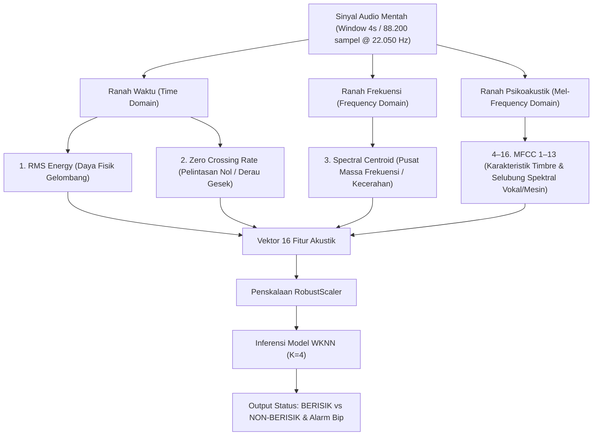

# Klasifikasi & Deteksi Real-Time Audio Berisik Menggunakan Weighted K-Nearest Neighbors (WKNN)

Selamat datang di sub-bab **Klasifikasi & Deteksi Real-Time Audio Berisik**. Bagian ini menyajikan studi kasus komprehensif dalam bidang **Sains Data dan Pengolahan Sinyal Digital (PSD)** yang berfokus pada pemantauan, klasifikasi, serta deteksi tingkat kebisingan lingkungan akustik secara *real-time* di **Laboratorium Teknik Informatika**.

Proyek ini mengimplementasikan siklus utuh sains data (*Data Science Lifecycle*) berbasis metodologi **CRISP-DM (Cross-Industry Standard Process for Data Mining)**, mulai dari pemahaman masalah bisnis, akuisisi dan pemrosesan sinyal suara mentah yang direkam langsung di dalam laboratorium, ekstraksi fitur spektral, pemodelan komparatif 12 algoritma *Machine Learning*, hingga *deployment* ke dalam aplikasi berbasis terminal (*CLI*) dan *web dashboard* interaktif (**Streamlit**) yang diimplementasikan di dalam laboratorium.

---

## 📌 Ringkasan Konfigurasi & Pencapaian Proyek

Sistem ini membagi sinyal rekaman suara ke dalam bingkai waktu **4.0 detik per segmen** dengan pergeseran jendela (*sliding window hop*) sebesar **1.0 detik (overlap 75%)** serta teknik **pembersihan jeda hening (*silence trimming*)**. Pendekatan ini menghasilkan **5.286 segmen fitur audio nyata** yang direkam langsung dari Laboratorium Teknik Informatika secara seimbang tanpa data sintetis, menghasilkan model klasifikasi yang sangat presisi dan andal untuk diterapkan di dunia nyata.

| Parameter Proyek | Spesifikasi Teknis | Keterangan & Rationale |
|---|---|---|
| **Domain Masalah** | Klasifikasi Audio Biner | Membedakan kondisi **Berisik (*Noisy*)** vs **Non-Berisik (*Clean/Quiet*)** di Lab |
| **Lokasi & Data** | Laboratorium Teknik Informatika | Sampel data direkam dan diimplementasikan langsung di dalam laboratorium |
| **Algoritma Terpilih** | **Weighted K-Nearest Neighbors (WKNN)** | Model berbasis instans dengan pembobotan jarak (*Distance-Weighted*) |
| **Jumlah Tetangga ($K$)** | $K = 4$ Tetangga | Menghilangkan potensi *tie* (imbang) pada klasifikasi biner |
| **Metrik Jarak** | Jarak Minkowski ($p=2$ / Euclidean) | Mengukur kedekatan geometris antarvektor 16 fitur spektral |
| **Skema Pembobotan** | *Inverse Distance Weighting* ($w = 1/d$) | Tetangga yang lebih dekat memiliki pengaruh probabilitas lebih besar |
| **Metode Normalisasi** | `RobustScaler` (Median & IQR) | Kebal terhadap letupan suara mendadak (*burst noise/outlier*) |
| **Panjang Jendela (*Window*)** | 4.0 Detik ($88.200$ sampel @ $22.050\text{ Hz}$) | Resolusi waktu optimal untuk menangkap karakteristik spektral stabil |
| **Pergeseran Jendela (*Hop*)**| 1.0 Detik ($22.050$ sampel / Overlap $75\%$) | Menghubungkan kesinambungan transisi suara antar-detik |
| **Pembersihan Hening** | $\text{RMS} \ge 0.015$ (Kelas Berisik) | Membuang jeda intro/outro kosong saat merekam (*silence trimming*) |
| **Total Segmen Fitur** | **5.286 baris segmen audio** | Terbagi seimbang: 2.732 Non-Berisik ($51.68\%$) vs 2.554 Berisik ($48.32\%$) |
| **Akurasi Data Uji (Test)** | **97.64%** ($N = 1.058$ sampel uji) | Mengungguli 11 algoritma pembanding lainnya |
| **5-Fold Cross Validation** | **97.58% (+/- 0.58%)** | Fold tertinggi mencapai **98.20%**, membuktikan stabilitas model |
| **Presisi Kelas Berisik** | **98.60%** | Sangat andal, meminimalkan alarm palsu (*false alarm* hanya $1.28\%$) |
| **Recall Non-Berisik** | **98.72%** | 540 dari 547 sampel audio tenang berhasil dikenali dengan sempurna |
| **Waktu Inferensi** | $< 0.005$ Detik per segmen 4s | Mampu memproses aliran mikrofon secara kontinu tanpa *delay* |

---

## 🔬 16 Fitur Akustik Pengolahan Sinyal Digital (PSD)

Sistem mengekstraksi **16 parameter akustik esensial** yang merepresentasikan karakteristik suara dari tiga ranah domain sinyal:

---

## 📚 Struktur Dokumentasi Proyek

Dokumentasi lengkap proyek ini disusun secara sistematis mengacu pada siklus hidup sains data (*Data Science Lifecycle*). Anda dapat menelusuri setiap tahapan melalui tautan berikut:

1. [**Business Understanding**](business-understanding.md): Membahas latar belakang polusi suara lingkungan, rumusan masalah, tujuan penelitian, manfaat bagi industri/akademisi, serta kriteria keberhasilan teknis dan bisnis.
2. [**Data Understanding**](data-understanding.md): Menjelaskan karakteristik dataset mentah (`berisik.zip` dan `non-berisik.zip`), dasar digitalisasi Nyquist-Shannon (22.050 Hz), teori matematis 16 fitur akustik PSD, serta analisis data eksploratif (EDA) terhadap distribusi fitur.
3. [**Data Preprocessing**](data-preprocessing.md): Membahas teknik segmentasi *sliding window* (4.0s / overlap 75%), algoritma pembersihan jeda hening (*silence trimming*), pembagian data latih-uji berstrata (*stratified split* 80:20), dan normalisasi `RobustScaler`.
4. [**Modeling**](modeling.md): Menguraikan perbandingan komparatif 12 algoritma klasifikasi *Machine Learning*, teori dasar algoritma *Weighted K-Nearest Neighbors (WKNN)*, hyperparameter tuning ($K=4$, pembobotan jarak terbalik, metrik Euclidean), dan penanganan *tie-breaker*.
5. [**Evaluation**](evaluation.md): Menyajikan analisis kinerja model secara mendalam menggunakan Classification Report, Matriks Kebingungan (*Confusion Matrix* 2x2), kurva ROC dan AUC, tabel benchmark 12 algoritma dengan 5-Fold Cross Validation, serta analisis waktu inferensi.
6. [**Deployment**](deployment.md): Mendokumentasikan implementasi sistem ke lingkungan produksi, mencakup ekspor artefak `.pkl`, skrip pemantauan mikrofon berbasis terminal (*CLI*) pada `live_audio_detect.py`, serta aplikasi web interaktif modern berbasis Streamlit pada `app.py`.
