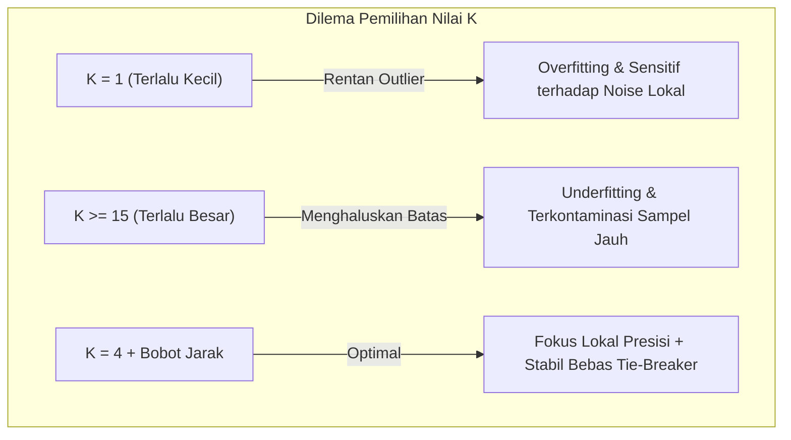

# Modeling

Tahap **Modeling** (Pemodelan) berfokus pada perancangan, eksperimen komparatif, dan penalaan (*hyperparameter tuning*) algoritma *Machine Learning* untuk mengklasifikasikan sinyal audio menjadi kelas **Berisik (*Noisy*)** atau **Non-Berisik (*Clean*)** berdasarkan 16 fitur akustik hasil pengolahan sinyal digital (PSD).

---

## 1. Metodologi Eksperimen Komparatif
Untuk menghindari bias pemilihan model yang bersifat subjektif, dilakukan eksperimen komparatif menyeluruh terhadap **12 algoritma klasifikasi Machine Learning** terkemuka dari berbagai paradigma:
- Model Berbasis Instans (*Instance-based / Lazy Learner*)
- Jaringan Syaraf Tiruan (*Neural Networks*)
- Model *Ensemble Tree* (*Bagging* dan *Boosting*)
- Model Pohon Keputusan Tunggal (*Decision Tree*)
- Model Pemisah Margin (*Support Vector Machines*)
- Model Linear & Probabilistik (*Logistic Regression* dan *Naive Bayes*)

Seluruh model dilatih menggunakan subset data latih yang sama (**4.228 sampel latih**) dan diuji pada subset data uji independen yang sama (**1.058 sampel uji**) setelah ditransformasikan oleh `RobustScaler`.

```text
Struktur Data Eksperimen:
├── Data Latih (Train Set): 4.228 baris segmen (80%) -> 5-Fold Stratified Cross Validation
└── Data Uji (Test Set)   : 1.058 baris segmen (20%) -> Evaluasi Independen Final
```

---

## 2. Rincian 12 Algoritma Klasifikasi yang Diuji

Berikut adalah konfigurasi parameter dari 12 algoritma yang diuji pada `train.ipynb`:

| No | Algoritma Machine Learning | Kategori Paradigma | Konfigurasi Hiperparameter Utama |
|:--:|---|---|---|
| **1** | **WKNN ($K=4$, distance)** | *Instance-Based* | $K=4$, `weights='distance'`, `metric='euclidean'` (**Model Terpilih**) |
| **2** | **Baseline KNN ($K=5$, uniform)** | *Instance-Based* | $K=5$, `weights='uniform'`, `metric='minkowski'` |
| **3** | **MLP (Multi-Layer Perceptron)** | *Neural Network* | 2 Hidden Layers (64, 32 neuron), fungsi aktivasi ReLU, solver Adam, max_iter=500 |
| **4** | **Extra Trees Classifier** | *Ensemble (Extremely Randomized)*| 100 estimator pohon, random_state=42 |
| **5** | **Random Forest Classifier** | *Ensemble (Bagging)* | 100 estimator pohon keputusan, bootstrap=True, random_state=42 |
| **6** | **Decision Tree Classifier** | *Decision Tree* | Algoritma CART, kriteria Gini impurity, random_state=42 |
| **7** | **Support Vector Machine (RBF)**| *Kernel Machine* | Kernel Radial Basis Function (RBF), $C=1.0$, probability=True |
| **8** | **Gradient Boosting** | *Ensemble (Boosting)* | 100 tahapan boosting sequential, learning_rate=0.1 |
| **9** | **AdaBoost Classifier** | *Ensemble (Adaptive Boosting)* | 50 decision stump estimators, learning_rate=1.0 |
| **10**| **Support Vector Machine (Linear)**| *Linear Margin* | Kernel Linear, $C=1.0$, probability=True |
| **11**| **Logistic Regression** | *Linear Probabilistic* | Solver L-BFGS, max_iter=1000, random_state=42 |
| **12**| **Gaussian Naive Bayes** | *Bayesian Probabilistic* | Asumsi distribusi Gaussian independen antarfitur |

---

## 3. Teori Mendalam Algoritma Weighted K-Nearest Neighbors (WKNN)
Berdasarkan hasil eksperimen komparatif, algoritma **Weighted K-Nearest Neighbors (WKNN)** keluar sebagai model terbaik dengan akurasi uji tertinggi mencapai **97.64%** dan rata-rata 5-Fold Cross Validation sebesar **97.58%**.

### A. Prinsip Dasar WKNN
WKNN adalah varian algoritma pembelajaran berbasis instans (*instance-based learning*) non-parametrik yang memberikan bobot berbeda pada setiap tetangga berdasarkan jaraknya. Model tidak membentuk fungsi keputusan eksplisit saat pelatihan (*zero training cost*), melainkan menyimpan seluruh vektor data latih ternormalisasi ke dalam ruang fitur 16 dimensi $\mathbb{R}^{16}$. Ketika sebuah segmen audio 4 detik baru masuk, sistem mencari $K$ sampel tetangga terdekat dari basis data latih.

### B. Perhitungan Jarak Geometris Euclidean
Jarak antara vektor segmen audio baru $x = (x_1, x_2, \dots, x_{16})$ dengan sampel data latih $x_i = (x_{i,1}, x_{i,2}, \dots, x_{i,16})$ dihitung menggunakan metrik Euclidean ($L_2$ norm):
$$d(x, x_i) = \|x - x_i\|_2 = \sqrt{\sum_{j=1}^{16} (x_j - x_{i,j})^2}$$

Di mana indeks $j \in \{1, 2, \dots, 16\}$ mewakili 16 fitur akustik (RMS, Spectral Centroid, ZCR, dan MFCC 1–13).

### C. Pembobotan Jarak Terbalik (*Inverse Distance Weighting*)
Pada model KNN standar (*baseline*), voting dilakukan secara seragam (*uniform*), di mana setiap tetangga memiliki hak suara yang sama (1 suara). Kelemahan pendekatan ini adalah sampel tetangga yang letaknya relatif jauh memiliki pengaruh voting yang setara dengan sampel yang sangat dekat.

Pada **WKNN (Weighted KNN)**, diterapkan fungsi pembobotan terbalik (*inverse distance*):
$$w_i = \frac{1}{d(x, x_i)}$$

Jika $d(x, x_i) = 0$ (sampel identik), maka $w_i = \infty$.

Probabilitas prediksi kelas $c \in \{0, 1\}$ dihitung melalui normalisasi akumulasi bobot tetangga:
$$P(y = c \mid x) = \frac{\sum_{i \in \mathcal{N}_K, \, y_i = c} w_i}{\sum_{i \in \mathcal{N}_K} w_i}$$

Di mana $\mathcal{N}_K$ adalah himpunan $K$ tetangga terdekat dari $x$. Kelas dengan total bobot terbesar ditetapkan sebagai hasil prediksi akhir:
$$\hat{y} = \arg\max_{c \in \{0, 1\}} P(y = c \mid x)$$

---

## 4. Rasionalisasi Pemilihan Hiperparameter ($K=4$ & Distance Weights)

Penetapan parameter $K=4$ dengan pembobotan jarak terbalik merupakan hasil penalaan (*tuning*) yang mempertimbangkan karakteristik data audio:



### 1. Mengapa Memilih $K=4$?
- Jika $K=1$, model sangat rentan terhadap pencilan (*outlier*). Suatu suara tenang yang kebetulan memiliki letupan sesaat akan langsung disalahartikan sebagai bising.
- Jika $K$ terlalu besar ($K \ge 15$), batas keputusan menjadi terlalu kabur (*over-smoothed*), sehingga fitur suara bising bertipe halus (*soft noise*) akan kalah suara oleh sampel tenang.
- Nilai $K=4$ memberikan lokalisasi keputusan yang sangat ketat di sekitar wilayah kerapatan spektral audio yang relevan.

### 2. Penanganan Masalah *Tie-Breaker* pada Klasifikasi Biner
Pada umumnya, praktisi Machine Learning menghindari penggunaan nilai $K$ genap (seperti $K=4$) pada klasifikasi biner jika menggunakan pembobotan seragam (*uniform*), karena ada kemungkinan terjadi hasil seri (2 suara kelas 0 vs 2 suara kelas 1).

Namun, pada **WKNN dengan bobot jarak ($w = 1/d$)**, nilai bobot dihitung dari jarak geometris bilangan riil kontinu ($d \in \mathbb{R}^+$). Peluang dua tetangga memiliki jarak yang sama persis secara matematis mendekati nol:
$$P\left(\sum_{y_i = 0} \frac{1}{d(x, x_i)} = \sum_{y_i = 1} \frac{1}{d(x, x_i)}\right) = 0$$

Dengan demikian, sistem tidak pernah mengalami kebuntuan (*tie-break deadlock*), sekaligus memanfaatkan keunggulan tetangga terdekat yang dominan.

---

## 5. Mengapa WKNN Mengungguli Model Kompleks Lainnya?
Tiga faktor utama mengapa WKNN menjadi pemenang di atas Random Forest, SVM, dan Neural Network (MLP) pada dataset ini:
1. **Representasi Fitur PSD yang Sudah Sangat Kompak:** Enam belas fitur akustik yang diekstraksi telah memiliki pemisahan klaster (*cluster separability*) yang sangat bersih di ruang $\mathbb{R}^{16}$. WKNN mampu mengeksploitasi kedekatan topologi lokal ini secara langsung tanpa perlu mempelajari fungsi aproksimasi global yang rumit.
2. **Efek Normalisasi RobustScaler:** Penerapan Median dan IQR meredam skala fitur secara proporsional, menjadikan metrik jarak Euclidean mencerminkan kedekatan akustik yang sesungguhnya.
3. **Efisiensi Memori & Latensi Nol:** Tidak membutuhkan arsitektur komputasi GPU, tidak memerlukan iterasi *backpropagation*, dan waktu inferensi per segmen berlangsung kurang dari **0.005 detik**.
