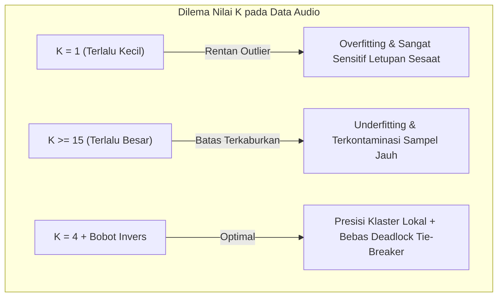

# Modeling

Dokumentasi fase keempat metodologi **CRISP-DM (Cross-Industry Standard Process for Data Mining)** untuk pemodelan komparatif 12 algoritma Machine Learning, teori dasar Weighted K-Nearest Neighbors (WKNN), serta penalaan hiperparameter ($K=4$, pembobotan jarak).

---

## 1. Metodologi Eksperimen Komparatif

Untuk mencegah bias subjektif dalam pemilihan algoritma, dilakukan pengujian komparatif menyeluruh terhadap **12 algoritma klasifikasi Machine Learning** dari berbagai paradigma:
1. Pembelajaran Berbasis Instans (*Instance-based / Lazy Learner*)
2. Jaringan Syaraf Tiruan (*Artificial Neural Networks*)
3. Model Ansambel Pohon (*Bagging* dan *Boosting*)
4. Pohon Keputusan Tunggal (*Decision Tree*)
5. Pemisah Margin Terlebar (*Support Vector Machines*)
6. Model Linear & Probabilistik (*Logistic Regression* dan *Naive Bayes*)

Seluruh model dilatih pada subset data latih yang sama (**4.228 sampel latih**) dan diuji pada subset data uji independen yang sama (**1.058 sampel uji**) setelah ditransformasikan menggunakan `RobustScaler`.

```text
Struktur Data Eksperimen:
├── Data Latih (Train Set): 4.228 baris segmen (80%) -> 5-Fold Stratified Cross Validation
└── Data Uji (Test Set)   : 1.058 baris segmen (20%) -> Evaluasi Independen Final
```

---

## 2. Rincian 12 Algoritma Klasifikasi yang Diuji

Berikut konfigurasi parameter dari 12 algoritma yang diuji secara komparatif:

| No | Algoritma Machine Learning | Kategori Paradigma | Konfigurasi Parameter Utama |
|:--:|---|---|---|
| **1** | **WKNN ($K=4$, distance)** | *Instance-Based* | $K=4$, `weights='distance'`, `metric='euclidean'` (**Model Terpilih**) |
| **2** | **Baseline KNN ($K=5$, uniform)** | *Instance-Based* | $K=5$, `weights='uniform'`, `metric='minkowski'` |
| **3** | **MLP (Multi-Layer Perceptron)** | *Neural Network* | 2 Hidden Layers (64, 32 neuron), fungsi aktivasi ReLU, solver Adam |
| **4** | **Extra Trees Classifier** | *Ensemble (Extremely Randomized)*| 100 estimator pohon, random_state=42 |
| **5** | **Random Forest Classifier** | *Ensemble (Bagging)* | 100 estimator pohon keputusan, bootstrap=True |
| **6** | **Decision Tree Classifier** | *Decision Tree* | Algoritma CART, kriteria Gini impurity |
| **7** | **Support Vector Machine (RBF)**| *Kernel Machine* | Kernel Radial Basis Function (RBF), $C=1.0$ |
| **8** | **Gradient Boosting** | *Ensemble (Boosting)* | 100 tahapan boosting sequential, learning_rate=0.1 |
| **9** | **AdaBoost Classifier** | *Ensemble (Adaptive Boosting)* | 50 decision stump estimators, learning_rate=1.0 |
| **10**| **Support Vector Machine (Linear)**| *Linear Margin* | Kernel Linear, $C=1.0$ |
| **11**| **Logistic Regression** | *Linear Probabilistic* | Solver L-BFGS, max_iter=1000 |
| **12**| **Gaussian Naive Bayes** | *Bayesian Probabilistic* | Asumsi distribusi Gaussian independen antarfitur |

---

## 3. Teori Mendalam Algoritma Weighted K-Nearest Neighbors (WKNN)

Berdasarkan hasil eksperimen komparatif, algoritma **Weighted K-Nearest Neighbors (WKNN)** keluar sebagai model terbaik dengan akurasi data uji tertinggi (**97.64%**) dan rata-rata 5-Fold Cross Validation sebesar **97.58%**.

### A. Prinsip Dasar WKNN
WKNN merupakan varian algoritma non-parametrik berbasis instans (*instance-based learning*). Model tidak membentuk fungsi keputusan eksplisit saat pelatihan (*zero training cost*), melainkan memetakan seluruh $4.228$ vektor sampel data latih ke dalam ruang berdimensi 16 ($\mathbb{R}^{16}$). Ketika ada segmen audio 4 detik baru yang masuk, sistem mencari $K$ sampel tetangga terdekat dari basis data latih berdasarkan kedekatan geometris.

### B. Perhitungan Jarak Geometris Euclidean
Jarak antara vektor segmen audio baru $x = (x_1, x_2, \dots, x_{16})$ dengan sampel data latih $x_i = (x_{i,1}, x_{i,2}, \dots, x_{i,16})$ dihitung menggunakan metrik Euclidean ($L_2$ norm):
$$d(x, x_i) = \|x - x_i\|_2 = \sqrt{\sum_{j=1}^{16} (x_j - x_{i,j})^2}$$

Di mana indeks $j \in \{1, 2, \dots, 16\}$ mewakili 16 fitur akustik PSD (RMS, Spectral Centroid, ZCR, dan MFCC 1–13).

### C. Pembobotan Jarak Terbalik (*Inverse Distance Weighting*)
Pada model KNN standar (*baseline*), *voting* dilakukan secara seragam (*uniform*), di mana setiap tetangga memiliki hak suara yang sama (1 suara). Kelemahan pendekatan ini adalah sampel tetangga yang posisinya berada di tepi batas (*boundary outlier*) memiliki bobot yang setara dengan sampel yang sangat dekat di pusat klaster.

Pada **WKNN (Weighted KNN)**, diterapkan fungsi pembobotan terbalik (*inverse distance*):
$$w_i = \frac{1}{d(x, x_i)}$$

Jika $d(x, x_i) = 0$ (sampel identik), maka $w_i = \infty$.

Probabilitas prediksi untuk kelas $c \in \{0, 1\}$ dihitung melalui normalisasi akumulasi bobot tetangga:
$$P(y = c \mid x) = \frac{\sum_{i \in \mathcal{N}_K, \, y_i = c} w_i}{\sum_{i \in \mathcal{N}_K} w_i}$$

Di mana $\mathcal{N}_K$ adalah himpunan $K$ tetangga terdekat dari $x$. Kelas dengan total bobot terbesar ditetapkan sebagai hasil prediksi akhir:
$$\hat{y} = \arg\max_{c \in \{0, 1\}} P(y = c \mid x)$$

---

## 4. Rasionalisasi Pemilihan Hiperparameter ($K=4$ & Distance Weights)

Penetapan parameter $K=4$ dengan pembobotan jarak terbalik merupakan hasil optimalisasi ilmiah yang mempertimbangkan karakteristik data audio:



### 1. Keunggulan Nilai $K=4$
- Jika $K=1$, model rentan terhadap pencilan (*outlier*). Suara letupan tunggal sesaat pada kondisi tenang akan langsung salah diklasifikasikan sebagai bising.
- Jika $K$ terlalu besar ($K \ge 15$), batas keputusan menjadi terlalu halus (*over-smoothed*), sehingga suara bising berkarakter lembut (*soft noise*) akan kalah suara oleh sampel tenang di sekitarnya.
- Nilai $K=4$ memberikan lokalisasi keputusan yang sangat ketat dan fokus di sekitar wilayah kerapatan spektral audio yang relevan.

### 2. Penanganan Masalah *Tie-Breaker* pada Klasifikasi Biner
Pada umumnya, praktisi Machine Learning menghindari penggunaan nilai $K$ genap (seperti $K=4$) pada klasifikasi biner jika menggunakan pembobotan seragam (*uniform*), karena ada kemungkinan terjadi hasil imbang (2 suara kelas 0 vs 2 suara kelas 1).

Namun, pada **WKNN dengan pembobotan jarak ($w = 1/d$)**, bobot dihitung dari jarak geometris bilangan riil kontinu ($d \in \mathbb{R}^+$). Peluang dua tetangga memiliki jarak yang identik secara matematis bernilai nol:
$$P\left(\sum_{y_i = 0} \frac{1}{d(x, x_i)} = \sum_{y_i = 1} \frac{1}{d(x, x_i)}\right) = 0$$

Dengan demikian, sistem tidak pernah mengalami kebuntuan (*tie-break deadlock*), sekaligus memanfaatkan keunggulan tetangga terdekat yang dominan.

---

## 5. Serialisasi Artefak Model

Setelah proses pelatihan dan validasi selesai pada `train.ipynb`, objek model diekspor ke disk dalam format biner pickle menggunakan pustaka `joblib`:
```python
import joblib

joblib.dump(chosen_wknn_model, "model_k_nearest_neighbors_knn.pkl")
```
Berkas `model_k_nearest_neighbors_knn.pkl` ini berukuran sekitar **$575\text{ KB}$**, memuat seluruh koordinat ruang 16-D dari $4.228$ sampel data latih, dan siap dimuat ke dalam memori RAM backend FastAPI pada saat server dinyalakan.
